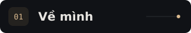
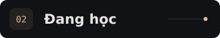
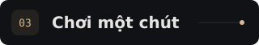
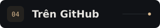
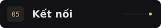

  

  

  <a href="#user-content-about">01 · Mình</a> &nbsp; / &nbsp;
  <a href="#user-content-learning">02 · Học</a> &nbsp; / &nbsp;
  <a href="#user-content-play">03 · Chơi</a> &nbsp; / &nbsp;
  <a href="#user-content-pulse">04 · GitHub</a> &nbsp; / &nbsp;
  <a href="#user-content-connect">05 · Kết nối</a>

 

**FAITT** 👋 · Học C++, thích giải bài toán và thử những ý tưởng nhỏ.

 

  
  &nbsp;
  
  &nbsp;
  

 

Đoán kết quả: `17 % 5` → **?**

Xem đáp án ↗

**2** — phần dư của `17 / 5`.

 

  
  &nbsp;
  
  &nbsp; · &nbsp; <a href="https://github.com/tai210507?tab=overview">Hoạt động ↗</a>

 

  
  

<a href="https://github.com/tai210507/tai210507/issues?q=is%3Aissue%20%22Hello%22%20in%3Atitle">Lời nhắn công khai</a> &nbsp; · &nbsp; <a href="#user-content-top">↑ Lên đầu</a> &nbsp; · &nbsp; <a href="ASSET-SOURCES.md">Visual credits</a>

