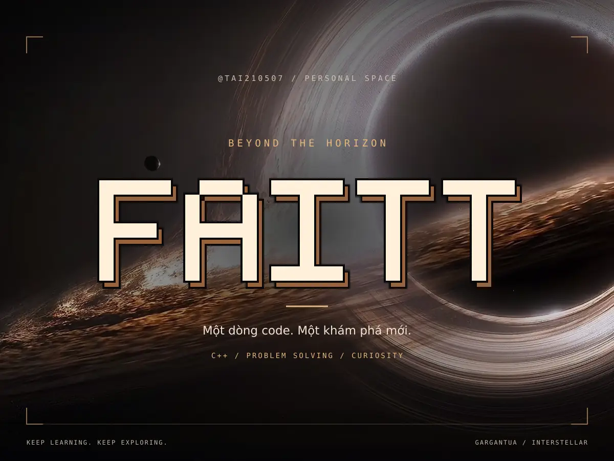
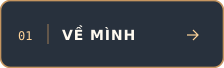
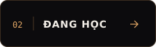
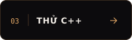
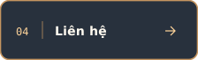
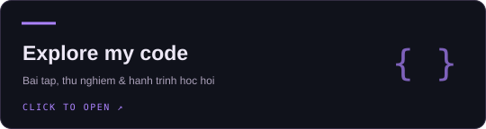
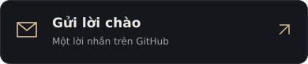

<a id="top"></a>
<p align="center">
  
</p>

<p align="center">
  
</p>

<p align="center">
  <a href="#user-content-about"></a>
  <a href="#user-content-learning"></a>
  <a href="#user-content-play"></a>
  <a href="#user-content-connect"></a>
</p>

<p align="center"><sub>Nhấn menu để khám phá · Bấm ▸ để mở các mục bên dưới</sub></p>

<a id="about"></a>

## 01 / Tín hiệu từ mình

### Chào bạn, mình là FAITT 👋

Mình đang học **C++**, rèn tư duy giải quyết vấn đề và thử những ý tưởng mới qua từng dòng code. Đây là góc nhỏ để mình ghi lại hành trình học hỏi — từng chút một, mỗi ngày.

> **Tò mò dẫn lối. Kiên trì đưa mình đi xa.**  
> Một dòng code. Một khám phá mới.

<details>
<summary><b>🌐 Read my introduction in English</b></summary>

Hi, I'm **FAITT**, also known as **@tai210507**. I'm learning C++ and practicing problem solving, one exercise at a time. This is my small space to learn, experiment and keep building.

**Still learning. Still curious. Still building.**

</details>

<details>
<summary><b>⌨️ Một lời chào bằng C++</b></summary>

```cpp
#include <iostream>

int main() {
    std::cout << "Hi, I'm FAITT.\n";
    std::cout << "Still learning. Still building.\n";
    return 0;
}
```

</details>

<br />

<a id="learning"></a>

## 02 / Quỹ đạo học tập

<p>
  <a href="https://github.com/tai210507?tab=repositories&amp;q=language%3AC%2B%2B"></a>
  <a href="https://github.com/tai210507?tab=repositories&amp;q=Lab"></a>
  <a href="https://github.com/tai210507?tab=repositories"></a>
</p>

<sub>Bấm vào từng huy hiệu để khám phá mã nguồn tương ứng.</sub>

<details open>
<summary><b>📚 Mình đang tập trung vào điều gì?</b></summary>

| Hướng học tập | Mục tiêu |
| :--- | :--- |
| **C++ nền tảng** | Hiểu cách chương trình hoạt động, thực hành qua bài tập |
| **Giải quyết vấn đề** | Chia bài toán thành các bước nhỏ, kiểm tra cách giải |
| **GitHub** | Lưu trữ mã nguồn và ghi lại quá trình học hỏi |

</details>

<details>
<summary><b>🧭 Cách mình tiếp cận một bài toán</b></summary>

1. Đọc đề và xác định đầu vào, đầu ra.
2. Thử một ví dụ nhỏ bằng tay.
3. Viết từng bước xử lý rồi chuyển thành code.
4. Kiểm tra các trường hợp đặc biệt và sửa lỗi.

*Đây là cách mình hướng tới khi luyện tập — tiến bộ từng chút một.*

</details>

<br />

<a id="play"></a>

## 03 / Trạm thử C++

**Thử một câu C++ nhỏ nhé:** chương trình này in ra số nào?

```cpp
int n = 1203, sum = 0;
while (n > 0) {
    sum += n % 10;
    n /= 10;
}
std::cout << sum;
```

<details>
<summary><b>💡 Mở gợi ý</b></summary>

`n % 10` lấy chữ số cuối. Với số nguyên dương, `n /= 10` bỏ chữ số cuối đó.

</details>

<details>
<summary><b>✨ Mở đáp án</b></summary>

Kết quả là **6**: các chữ số được cộng theo thứ tự `3 + 0 + 2 + 1`.

Đoạn code giả sử đã có `#include <iostream>` và được đặt trong `main()`.

</details>

<br />

<a id="pulse"></a>

## 04 / Tín hiệu GitHub

<p>
  <a href="https://github.com/tai210507?tab=followers"></a>
  <a href="https://github.com/tai210507?tab=repositories&amp;sort=stargazers"></a>
</p>

[Khám phá các repository ↗](https://github.com/tai210507?tab=repositories) · [Xem hoạt động đóng góp ↗](https://github.com/tai210507?tab=overview)

<sub>Huy hiệu lấy dữ liệu công khai từ GitHub qua Shields.io và có thể cập nhật chậm do bộ nhớ đệm.</sub>

<br />

<a id="connect"></a>

## 05 / Mở kênh kết nối

<p align="center">
  <a href="https://github.com/tai210507?tab=repositories"></a>
  <a href="https://github.com/tai210507/tai210507/issues/new?template=hello.yml"></a>
</p>

**Có chung hứng thú với lập trình?** Bạn có thể gửi lời chào, góp ý cho profile hoặc chia sẻ một điều vừa học được.

[✉️ Viết lời chào](https://github.com/tai210507/tai210507/issues/new?template=hello.yml) · [💬 Đọc các lời nhắn](https://github.com/tai210507/tai210507/issues?q=is%3Aissue%20%22Hello%22%20in%3Atitle) · [↑ Về đầu trang](#user-content-top)

<sub>Lời nhắn được đăng công khai bằng tài khoản GitHub của bạn sau khi bạn nhấn tạo issue.</sub>

<p align="center"><sub>Interstellar / Gargantua · <a href="ASSET-SOURCES.md">Visual credits</a></sub></p>

<br />
<p align="center"></p>


