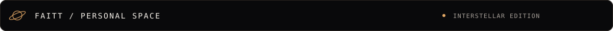

<p align="center">
  
</p>

<p align="center">
  <a href="https://tai210507.github.io"></a>
  <a href="https://github.com/tai210507?tab=repositories"></a>
</p>

### Một chút về mình

Chào bạn, mình là **FAITT** 👋

Mình đang học **C++**, rèn tư duy giải quyết vấn đề và thử những ý tưởng mới qua từng dòng code. Đây là góc nhỏ để mình ghi lại hành trình học hỏi — từng chút một, mỗi ngày.

```cpp
#include <iostream>

int main() {
    std::cout << "Hi, I'm FAITT.\n";
    std::cout << "Still learning. Still building.\n";
    return 0;
}
```

### Đang học & khám phá

<p>
  
  
  
</p>

- Củng cố nền tảng lập trình với C++.
- Luyện phân tích bài toán và cách giải.
- Lưu lại những gì mình học được trên GitHub.

### Ghé thăm góc nhỏ của mình

[Website cá nhân ↗](https://tai210507.github.io) · [Các repository ↗](https://github.com/tai210507?tab=repositories)

---

<p align="center"><sub>CURIOSITY · CODE · GROWTH<br>One line of code. One step forward.</sub></p>
